<div align="center">

# CitaSalón

### Las reservas llegan por WhatsApp. El salón las gestiona desde su agenda.

Bot de citas para peluquerías con paneles de administración y recepción, disponibilidad por profesional y recordatorios.

**Proyecto personal desarrollado con IA mediante OmniRoute, actualmente en fase de pruebas y mejora.**

[](https://github.com/qirris/citasalon/actions/workflows/ci.yml)


[Historia](#por-qué-creé-citasalón) · [Mi aportación e IA](#mi-aportación-y-uso-de-ia) · [Estado](#estado-actual-y-próximos-pasos) · [WhatsApp](#así-se-reserva-por-whatsapp) · [Capturas](#así-se-ve) · [Arranque local](#probar-en-local) · [Arquitectura](#cómo-funciona) · [Documentación](#documentación)

</div>

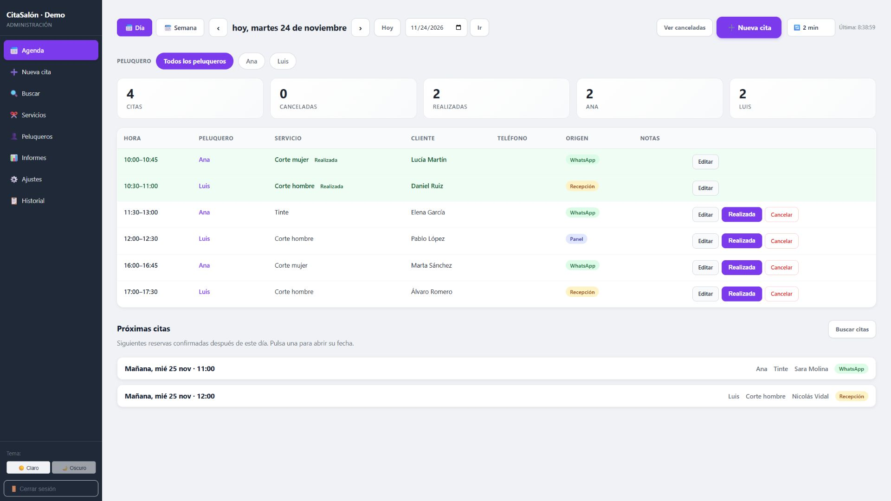

<p align="center"><sub>Captura real de la aplicación en local. Todos los nombres y las citas son ficticios.</sub></p>

## Por qué creé CitaSalón

La idea surgió hablando con un amigo peluquero que gestionaba sus citas por WhatsApp. Entre su trabajo y los mensajes, algunas solicitudes se quedaban sin responder o resultaban difíciles de organizar. Al observar que otros peluqueros de mi pueblo trabajaban de forma similar, decidí explorar una solución que automatizara las reservas y que pudiera ofrecer como servicio.

Me interesaba aprender cómo construir automatizaciones útiles y explorar una oportunidad de negocio a partir de una necesidad cercana. El objetivo de CitaSalón es reducir la gestión manual de las citas y ayudar a que las solicitudes de reserva no se pierdan entre conversaciones.

## Mi aportación y uso de IA

Utilicé modelos de IA gratuitos a través de **OmniRoute** para generar y corregir código a partir de mis indicaciones. El desarrollo fue iterativo: definía lo que necesitaba, probaba el resultado y pedía cambios o correcciones al encontrar problemas.

Mi trabajo se centró en:

- **Investigar y definir la solución:** entender la necesidad, decidir las funcionalidades y concretar cómo debían funcionar las reservas y los paneles.
- **Trabajar en las integraciones:** configurar la conexión con WhatsApp mediante Meta Developers y el entorno del proyecto en Cloudflare, con asistencia de IA.
- **Probar e iterar:** realizar pruebas por WhatsApp con amigos y familiares, detectar errores y dirigir las siguientes correcciones a partir de lo observado.

Actualmente mi aprendizaje se centra en entender el flujo completo del sistema, sus integraciones y su configuración.

**La IA se utilizó durante el desarrollo.** El bot que atiende las reservas funciona mediante reglas y estados de conversación; no utiliza un modelo generativo para responder a cada mensaje.

## Retos y aprendizajes

Uno de los problemas que más encontré durante las pruebas fue que WhatsApp no respondía aunque la configuración pareciera correcta. En una de las incidencias documentadas, el diagnóstico asistido identificó que la configuración del webhook del número seguía apuntando a una dirección de pruebas antigua. Tras corregirla, los mensajes volvieron a llegar al bot.

Mi participación consistió en probar los mensajes, detectar que el resultado no era el esperado y continuar las comprobaciones y correcciones con ayuda de IA. Esta experiencia me ayudó a entender la importancia de comprobar el recorrido completo de un mensaje entre WhatsApp, Meta y el servidor, además de verificar la interfaz.

## Estado actual y próximos pasos

He probado el proyecto durante el desarrollo con amigos y familiares. Estas pruebas me han servido para encontrar errores en el bot y mejorar sus recorridos. **Todavía no he realizado un piloto en una peluquería ni he medido resultados comerciales o ahorro de tiempo.**

Mis próximos pasos son:

1. **Reforzar la fiabilidad:** seguir comprobando las respuestas, las reservas y los cambios de citas antes de ofrecer el servicio.
2. **Realizar un piloto en un salón:** contrastar el funcionamiento con el trabajo diario de un peluquero y recoger sus comentarios.
3. **Estudiar la continuidad del servicio:** evaluar cómo disponer de una alternativa si Cloudflare deja de estar disponible.

El proyecto ya incluye herramientas de copias de seguridad para recuperar datos. Mantener el servicio operativo durante una caída del proveedor es un objetivo distinto: **actualmente no hay un entorno alternativo ni un cambio automático a otro proveedor**.

## Qué puedes hacer

| Para el cliente | Para el salón |
| --- | --- |
| Reservar desde WhatsApp con botones o texto libre. | Consultar la agenda diaria y semanal, con filtros por peluquero. |
| Elegir servicio, profesional, día y hora disponible. | Crear, editar, cancelar y marcar citas como realizadas. |
| Consultar, reprogramar y cancelar sus propias citas. | Configurar servicios, precios, horarios, descansos y ausencias. |
| Recibir recordatorios y avisos mediante plantillas de Meta. | Consultar informes por periodo, exportar CSV y revisar el historial. |

La disponibilidad tiene en cuenta la duración del servicio, el horario de cada peluquero, sus ausencias y las citas existentes. Las reservas vuelven a comprobarse al confirmar para evitar solapes.

## Así se ve

Aquí se muestran dos partes del producto: la conversación del cliente en WhatsApp y los paneles que utiliza el salón. Puedes pulsar cada imagen para verla a tamaño completo.

### Así se reserva por WhatsApp

Capturas reales de pruebas anteriores proporcionadas por el autor, con los teléfonos y el nombre del cliente ocultos. Muestran el recorrido observado durante esas pruebas; no son un enlace a una demostración pública activa ni sustituyen la validación operativa de la versión actual.

<table>
  <tr>
    <th>1. Iniciar la reserva</th>
    <th>2. Elegir una hora</th>
    <th>3. Recibir la confirmación</th>
  </tr>
  <tr>
    <td valign="top" align="center"><a href="docs/capturas/whatsapp-inicio.jpg">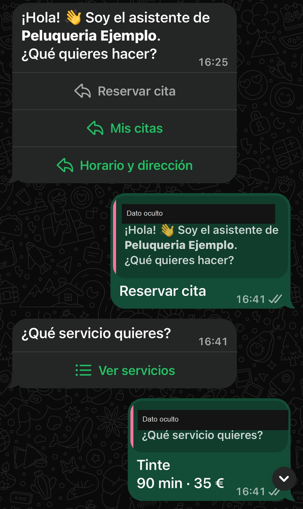</a></td>
    <td valign="top" align="center"><a href="docs/capturas/whatsapp-horas.jpg">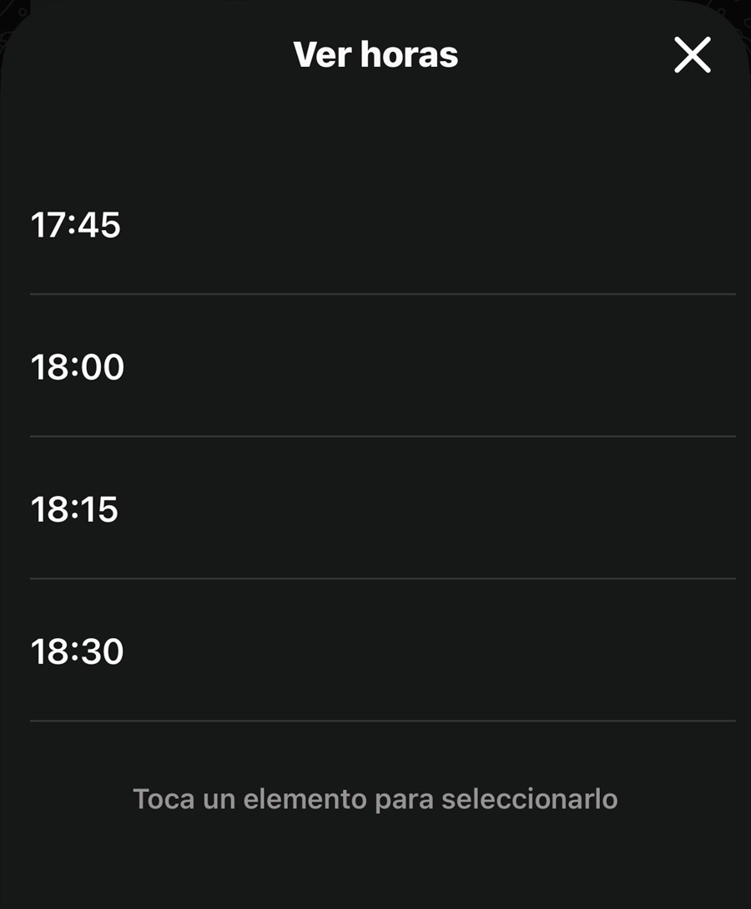</a></td>
    <td valign="top" align="center"><a href="docs/capturas/whatsapp-confirmacion.jpg">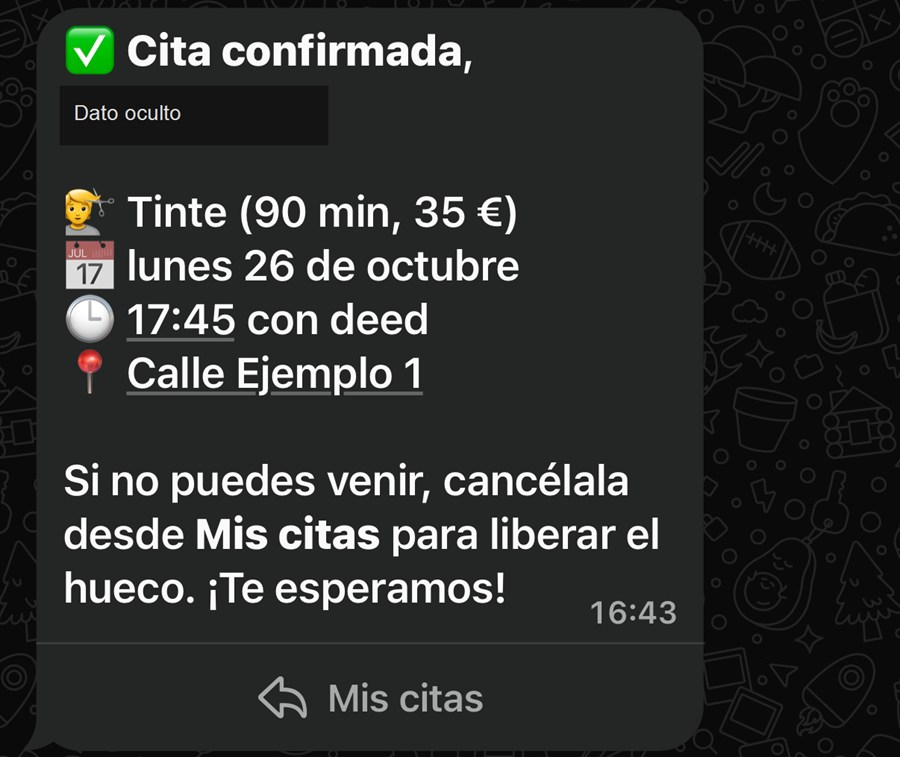</a></td>
  </tr>
  <tr>
    <td valign="top">El cliente inicia la conversación, pulsa «Reservar cita» y selecciona un servicio.</td>
    <td valign="top">El bot ofrece horarios disponibles para el servicio, profesional y día elegidos.</td>
    <td valign="top">Tras confirmar, el cliente recibe el resumen de su reserva y el acceso a «Mis citas».</td>
  </tr>
</table>

### Consulta de citas y avisos

La conversación también permite consultar las próximas reservas. Los avisos muestran ejemplos recibidos durante las pruebas al cancelar o actualizar una cita.

<table>
  <tr>
    <th>Mis citas</th>
    <th>Avisos automáticos</th>
  </tr>
  <tr>
    <td valign="top" align="center"><a href="docs/capturas/whatsapp-mis-citas.jpg">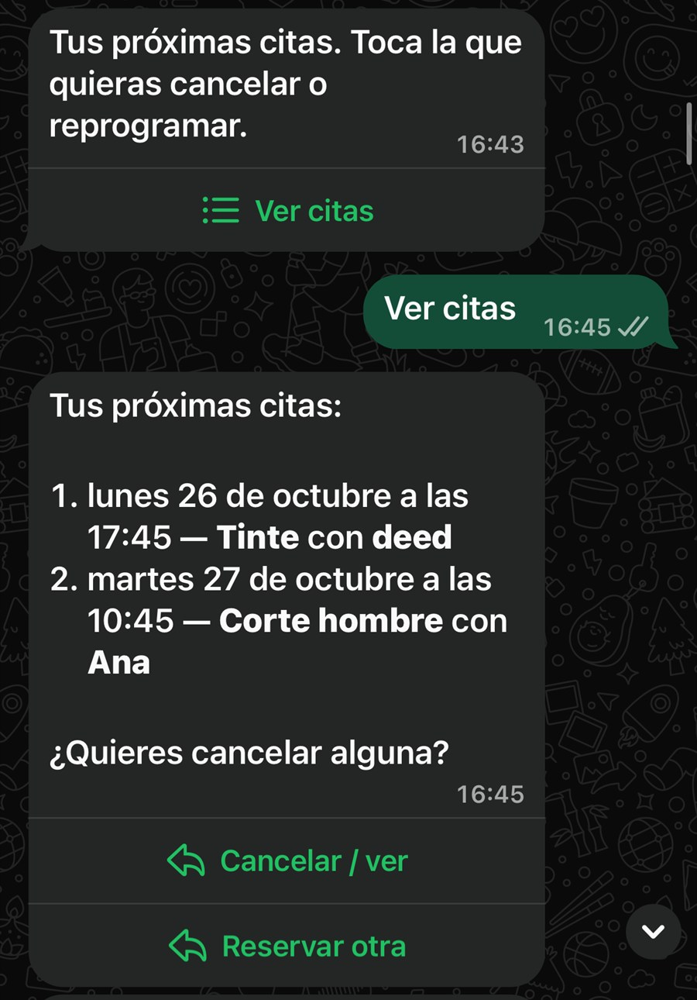</a></td>
    <td valign="top" align="center"><a href="docs/capturas/whatsapp-avisos.jpg">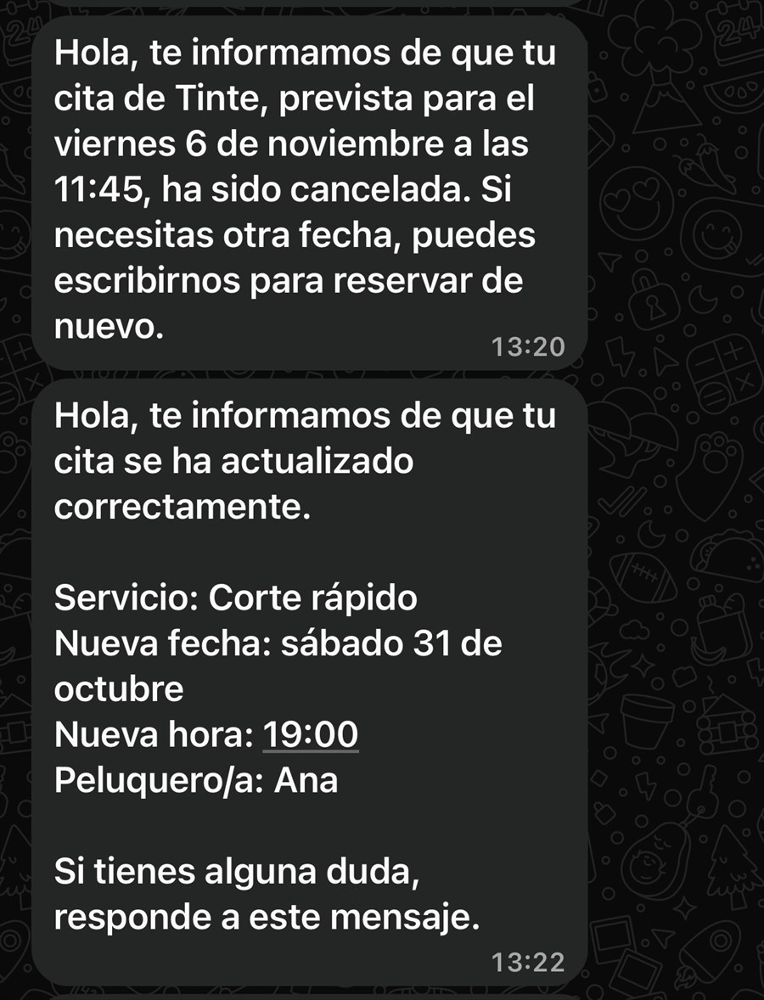</a></td>
  </tr>
  <tr>
    <td valign="top">Desde «Mis citas», el cliente consulta sus próximas reservas y accede a su gestión.</td>
    <td valign="top">Un aviso comunica la cancelación; el otro informa del servicio, la nueva fecha, la hora y la profesional de una cita actualizada.</td>
  </tr>
</table>

### Paneles del salón

Las siguientes capturas se tomaron ejecutando el código del repositorio en un navegador, con una D1 local de demostración y datos ficticios.

#### Recepción desde el móvil

Agenda con navegación por fechas, filtro por profesional y tarjetas de citas con acciones rápidas.

<table>
  <tr>
    <th>Agenda y filtros</th>
    <th>Tarjetas de citas</th>
  </tr>
  <tr>
    <td align="center"><a href="docs/capturas/recepcion-movil.jpg">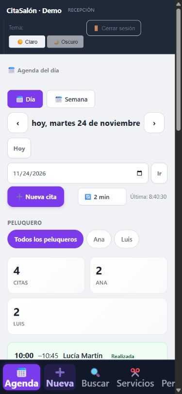</a></td>
    <td align="center"><a href="docs/capturas/recepcion-tarjetas.jpg">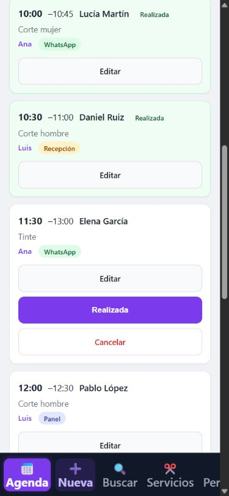</a></td>
  </tr>
</table>

#### Crear una cita

El formulario muestra los huecos disponibles para el servicio, el profesional y la fecha elegidos.

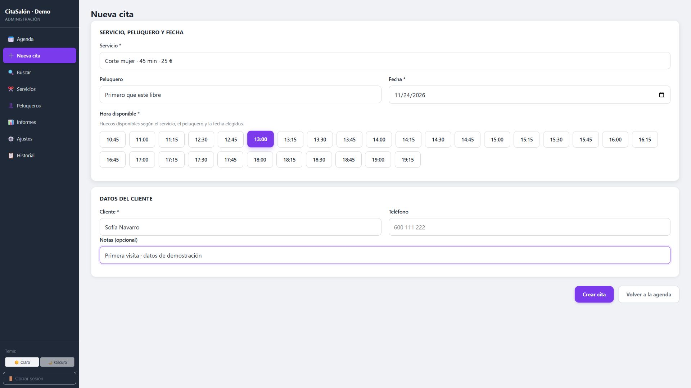

#### Informes del salón

Resumen por fechas, desglose por profesional y servicio, y descarga en CSV. Los importes se calculan con el precio actual de los servicios; no representan cobros ni facturas.

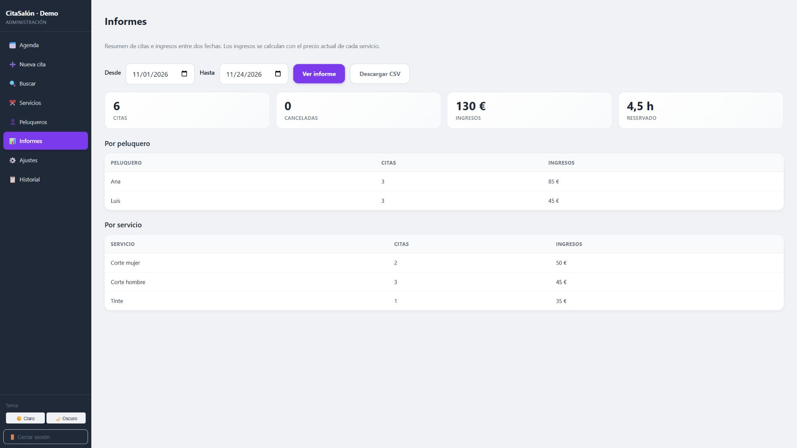

## Cómo funciona

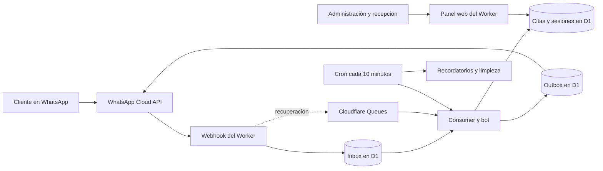

El Inbox deduplica los mensajes por WAMID y conserva el orden por teléfono. El Consumer guarda los cambios de negocio, la sesión y las respuestas en una operación atómica; el Outbox gestiona los envíos y sus reintentos. La cola y el cron permiten recuperar trabajo pendiente.

**Una instalación por salón:** cada peluquería utiliza su propio Worker, D1, cola y secretos. El proyecto no es multi-tenant.

| Capa | Tecnología |
| --- | --- |
| Aplicación | TypeScript en Cloudflare Workers |
| Persistencia y mensajería | D1 (SQLite), Inbox/Outbox y Cloudflare Queues |
| Conversación | WhatsApp Cloud API de Meta |
| Paneles | HTML generado en servidor, formularios y redirecciones 303 |
| Experiencia web | Vistas de escritorio y móvil, temas claro/oscuro y manifest PWA |
| Herramientas | Wrangler, GitHub Actions, Node.js, PowerShell y scripts Python para backups |

## Probar en local

Necesitas **Node.js 24 o superior** y npm. No hace falta conectar WhatsApp para explorar los paneles.

```powershell
git clone https://github.com/qirris/citasalon.git
cd citasalon
npm ci
Copy-Item .dev.vars.example .dev.vars
```

Configura en `.dev.vars` las contraseñas locales `ADMIN_PASSWORD` y `STAFF_PASSWORD`, y un `SESSION_SECRET` de al menos 32 caracteres. La plantilla es solo para desarrollo; utiliza valores propios antes de desplegar.

```powershell
# Crea el esquema en la base local, sin acceder a la D1 remota.
npx wrangler d1 execute citasalon --local --file=schema.sql
npm run dev
```

Abre [administración](http://localhost:8787/admin) o [recepción](http://localhost:8787/recepcion) e introduce la contraseña correspondiente. Una instalación nueva arranca sin citas; los datos de las capturas son de demostración.

| Ruta | Acceso | Uso |
| --- | --- | --- |
| `/admin` | Administrador | Agenda, citas, servicios, personal, ajustes, informes e historial. |
| `/recepcion` | Recepción o administrador | Trabajo diario con agenda, citas, servicios y personal. |
| `/qr` | Público | Cartel con QR para iniciar la conversación de WhatsApp. |
| `/qr-recepcion` | Público | Cartel de acceso al panel de recepción. |
| `/health` | Público | Comprobación del Worker. |

Sin `WHATSAPP_TOKEN`, los mensajes quedan en **modo consola**. Para enviar mensajes reales hacen falta la configuración de Meta, sus credenciales y las plantillas que se vayan a utilizar. Las pruebas manuales realizadas durante el desarrollo no sustituyen una validación operativa completa, incluida la entrega de mensajes y avisos por Meta antes de instalarlo en un salón; consulta los [pendientes](instrucciones/TAREAS_PENDIENTES.md).

## Seguridad y operación

- Sesiones firmadas con HMAC-SHA256 y cookies `HttpOnly` / `SameSite=Strict`.
- Validación de `Origin`, políticas CSP por página y SQL parametrizado.
- Roles separados, bloqueo de login y límites de peticiones por sesión e IP.
- Validación de firma del webhook mediante `APP_SECRET` cuando está configurado.
- Copias manuales de D1 con validación, cifrado AES-256-GCM y herramientas de restauración aislada.

Los secretos se guardan en `.dev.vars` para desarrollo o con `wrangler secret put` en producción. Cada instalación debe aportar su propia configuración. El repositorio contiene ejemplos, no credenciales de una instalación real.

La PWA incluye manifest e iconos; **no incorpora funcionamiento offline**. Antes de instalar en un salón real, sigue la [puesta en marcha](docs/PUESTA_EN_MARCHA.md) y su checklist.

## Verificación

```powershell
npm run check      # Comprobación de tipos
npm run test:all   # Pruebas unitarias y auxiliares
```

La [CI](https://github.com/qirris/citasalon/actions/workflows/ci.yml) ejecuta esas comprobaciones y valida la sintaxis de `setup.ps1` en cada push a `master` y en pull requests.

El E2E comprueba el bot y los paneles contra Wrangler local. Su última ejecución documentada fue **189/189, sin fallos, el 30 de octubre de 2026**; no es una verificación de la entrega de mensajes en producción.

> `npm run e2e` **vacía las tablas de la D1 local** antes de comenzar y necesita el servidor local en ejecución. Ejecútalo únicamente en una base de pruebas cuyos datos puedas descartar. Los resultados y límites de las verificaciones están en [memoria.md](memoria.md).

<details>
<summary><strong>Mapa del código</strong></summary>

| Archivo | Responsabilidad |
| --- | --- |
| [`src/index.ts`](src/index.ts) | Webhook, rutas públicas, cola y tareas programadas. |
| [`src/bot.ts`](src/bot.ts) | Estados de conversación y selección de respuestas e intenciones. |
| [`src/consumer.ts`](src/consumer.ts) | Procesamiento del Inbox, bloqueo por teléfono, transacciones y Outbox. |
| [`src/db.ts`](src/db.ts) | Acceso a D1, citas, sesiones y auditoría. |
| [`src/availability.ts`](src/availability.ts) | Horarios y cálculo de huecos disponibles. |
| [`src/panels.ts`](src/panels.ts) | Paneles, formularios, agenda e informes. |
| [`src/auth.ts`](src/auth.ts) | Sesiones, HMAC y validación de origen. |
| [`src/whatsapp.ts`](src/whatsapp.ts) | Envío de mensajes por Meta. |
| [`src/reminders.ts`](src/reminders.ts) / [`src/notices.ts`](src/notices.ts) | Recordatorios y avisos de citas. |
| [`src/config.ts`](src/config.ts) | Configuración del salón y valores por defecto. |
| [`src/pwa.ts`](src/pwa.ts) | Manifest, iconos y cartel de recepción. |
| [`schema.sql`](schema.sql) / [`migrations/`](migrations/) | Esquema completo y migraciones para instalaciones existentes. |

</details>

## Documentación

| Quiero… | Leer |
| --- | --- |
| Orientarme en el proyecto | [Índice de documentación](docs/INDICE_DOCUMENTACION.md) |
| Instalarlo para un salón | [Puesta en marcha](docs/PUESTA_EN_MARCHA.md) |
| Personalizar servicios, personal y horarios | [Configuración de una peluquería real](docs/CONFIGURACION_PELUQUERIA_REAL.md) y [plantillas de datos](datos-salon/) |
| Consultar rutas y permisos | [Rutas y API](docs/RUTAS_Y_API.md) |
| Entender las tablas | [Modelo de datos](docs/MODELO_DE_DATOS.md) |
| Desplegar, hacer backups o restaurar | [Operación y despliegue](docs/OPERACION_Y_DESPLIEGUE.md) |
| Contribuir o continuar el desarrollo | [AGENTS.md](AGENTS.md), [memoria](memoria.md) y [tareas pendientes](instrucciones/TAREAS_PENDIENTES.md) |

<sub>Capturas reales de pruebas de WhatsApp con datos personales ocultos y de paneles locales con datos ficticios. [Detalles de las capturas](docs/capturas/README.md).</sub>
